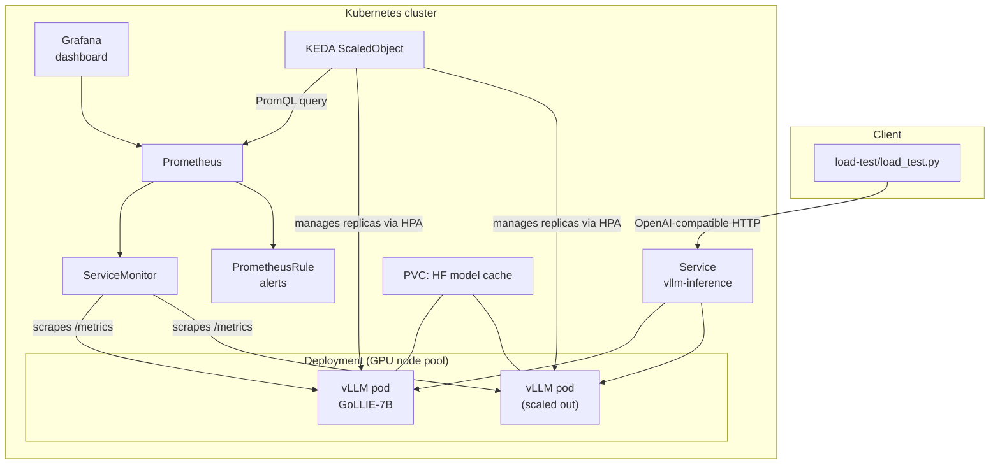

# ai-inference-platform

A self-contained reference implementation of an AI inference platform on
Kubernetes: GPU-scheduled model serving with [vLLM](https://github.com/vllm-project/vllm),
request-driven autoscaling with [KEDA](https://keda.sh), and
Prometheus/Grafana observability — plus a load-testing script to drive and
observe it end to end.

> **Why this project exists.** I build and operate LLM inference
> infrastructure professionally, but that work is my employer's proprietary
> system and isn't mine to publish. This repository is an **independent,
> from-scratch demonstration** built entirely with public, open-source
> components (vLLM, KEDA, Prometheus, Grafana) and an open-weight model. It
> is inspired by the *category* of problems that kind of infrastructure
> solves — GPU scheduling, autoscaling on inference-specific signals,
> latency/throughput observability — not a copy, derivative, or reproduction
> of any employer's code, configuration, or internal design. Everything in
> this repo was written for this project and can be reproduced by anyone
> from the instructions below.

## Architecture



**Request path:** the load tester (or any client) calls the Service's
OpenAI-compatible API, which load-balances across vLLM pods. **Scaling
path:** every pod exposes vLLM's built-in Prometheus metrics; KEDA polls
Prometheus for in-flight + queued request depth and adjusts replica count
(via an HPA it manages) within `minReplicaCount`/`maxReplicaCount`.
**Observability path:** the same metrics feed a Grafana dashboard and a set
of alerting rules, independent of the autoscaling path.

## Components

| Concern              | Tool                              | Where |
|----------------------|------------------------------------|-------|
| Model serving         | vLLM OpenAI-compatible server      | `helm/vllm-inference/templates/deployment.yaml` |
| GPU scheduling        | `resources`, `nodeSelector`, `tolerations`, `affinity` | `helm/vllm-inference/values.yaml`, `values-gpu-node-pool.yaml` |
| Model weights caching | PersistentVolumeClaim              | `helm/vllm-inference/templates/pvc.yaml` |
| Autoscaling           | KEDA `ScaledObject` (Prometheus trigger) | `helm/vllm-inference/templates/keda-scaledobject.yaml` |
| Metrics scraping      | Prometheus Operator `ServiceMonitor` | `helm/vllm-inference/templates/servicemonitor.yaml` |
| Alerting              | `PrometheusRule`                   | `monitoring/prometheus/prometheus-rules.yaml` |
| Dashboards            | Grafana JSON dashboard             | `monitoring/grafana/dashboards/` |
| Load testing          | Async Python client                | `load-test/load_test.py` |
| Offline validation    | `helm lint`/`template` (+ optional kubeconform) | `scripts/validate.sh` |

## Key technical decisions

**Model: [`HiTZ/GoLLIE-7B`](https://huggingface.co/HiTZ/GoLLIE-7B).** A 7B,
open-weight, CodeLlama-architecture model — small enough to fit on a single
24GB-class GPU (L4/A10) in fp16, which keeps the GPU bill for reproducing
this demo low, while still being large enough to exercise real scheduling,
queuing, and latency behavior under load. The chart is model-agnostic: every
model-specific setting (`model.name`, `dtype`, `maxModelLen`,
`gpuMemoryUtilization`) is a Helm value, so swapping in any other vLLM-
supported model is a one-line override, not a template change. Note GoLLIE's
weights carry Meta's Llama 2 Community License (inherited from Code Llama),
separate from this repo's own MIT license on the code/config in it.

**KEDA over a plain HPA.** Kubernetes' built-in HPA scales on CPU/memory by
default, which is a poor proxy for LLM serving load — a GPU can be
CPU-idle while its KV cache and request queue are saturated. KEDA's
Prometheus scaler lets the autoscaling signal be vLLM's own
`num_requests_running`/`num_requests_waiting`, i.e. the thing that actually
determines user-facing latency. KEDA creates and manages an HPA under the
hood, so this is additive to, not a replacement for, standard Kubernetes
autoscaling.

**GPU scheduling is config, not code.** `nodeSelector`/`tolerations`/
`affinity`/`resources.requests."nvidia.com/gpu"` are all plain Helm values
with empty/placeholder defaults (so the chart installs and lints without any
real GPU nodes), and a separate `values-gpu-node-pool.yaml` shows a realistic
override for a dedicated, tainted GPU node pool. This mirrors how GPU
scheduling is actually done in production: the scheduling *policy* is
environment-specific and belongs in values overrides per cluster, not
hardcoded in templates.

**Offline-first validation.** `scripts/validate.sh` runs `helm lint` and
`helm template` against both the default values and the GPU override, and
optionally runs [`kubeconform`](https://github.com/yannh/kubeconform) (a
standalone schema validator that never contacts a cluster or reads a
kubeconfig) if installed. None of this requires a Kubernetes cluster, a
GPU, or network access to any live API server — you can validate the whole
chart on a laptop.

**Model weights are cached, not baked into the image.** vLLM downloads
weights from the Hub on first start; a PVC (`modelCache` in values.yaml)
persists them across pod restarts/rescheduling so you don't re-pull ~14GB
every time a pod moves. For air-gapped or faster-cold-start environments,
point `image.repository`/`model.revision` at a custom image with weights
baked in instead — not implemented here, to keep the example reproducible
from public sources only.

## Repository layout

```
ai-inference-platform/
├── helm/vllm-inference/        # the Helm chart
│   ├── Chart.yaml
│   ├── values.yaml             # defaults — no GPU required to lint/template
│   ├── values-gpu-node-pool.yaml
│   └── templates/
│       ├── deployment.yaml
│       ├── service.yaml
│       ├── pvc.yaml
│       ├── servicemonitor.yaml
│       ├── keda-scaledobject.yaml
│       ├── _helpers.tpl
│       └── NOTES.txt
├── monitoring/
│   ├── prometheus/prometheus-rules.yaml
│   └── grafana/dashboards/vllm-inference-dashboard.json
├── load-test/
│   ├── load_test.py
│   ├── requirements.txt
│   └── README.md
├── scripts/validate.sh          # offline chart validation, no cluster/GPU needed
└── LICENSE
```

## Prerequisites

- A Kubernetes cluster with at least one GPU node (24GB+ VRAM recommended
  for fp16 7B models), with the NVIDIA device plugin installed.
- [KEDA](https://keda.sh/docs/latest/deployment/) installed in-cluster
  (for autoscaling).
- [kube-prometheus-stack](https://github.com/prometheus-community/helm-charts/tree/main/charts/kube-prometheus-stack)
  (or standalone Prometheus Operator + Grafana) installed in-cluster (for
  monitoring). Not required just to deploy the model server.
- Helm 3, `kubectl`.

None of the above are required to **validate** the chart — see
[Validating without a cluster or GPU](#validating-without-a-cluster-or-gpu).

## Deploying

```bash
# 1. Install KEDA (if not already present)
helm repo add kedacore https://kedacore.github.io/charts
helm install keda kedacore/keda --namespace keda --create-namespace

# 2. Install kube-prometheus-stack (if not already present)
helm repo add prometheus-community https://prometheus-community.github.io/helm-charts
helm install kube-prometheus-stack prometheus-community/kube-prometheus-stack \
  --namespace monitoring --create-namespace

# 3. Deploy the model server, pointed at your GPU node pool
helm install gollie ./helm/vllm-inference \
  -f ./helm/vllm-inference/values-gpu-node-pool.yaml \
  --set autoscaling.prometheusAddress=http://kube-prometheus-stack-prometheus.monitoring.svc.cluster.local:9090

# 4. Wire up alerts + dashboard
kubectl apply -f monitoring/prometheus/prometheus-rules.yaml -n monitoring
# Import monitoring/grafana/dashboards/vllm-inference-dashboard.json via the
# Grafana UI, or mount it as a dashboard-provisioning ConfigMap.
```

`values-gpu-node-pool.yaml`'s `nodeSelector`/`tolerations` are placeholders —
match them to your actual cluster's GPU node labels/taints (examples for
GKE/EKS are commented in that file).

### Gated or private models

Don't put a Hugging Face token in values.yaml (it would end up in your Helm
release history / git). Instead:

```bash
kubectl create secret generic hf-token --from-literal=token=<HF_TOKEN>
helm upgrade gollie ./helm/vllm-inference --set huggingface.tokenSecretName=hf-token
```

### Trying it

```bash
kubectl port-forward svc/gollie-vllm-inference 8000:8000
curl http://localhost:8000/v1/completions \
  -H "Content-Type: application/json" \
  -d '{"model": "HiTZ/GoLLIE-7B", "prompt": "San Francisco is a", "max_tokens": 32}'
```

## Validating without a cluster or GPU

```bash
./scripts/validate.sh
```

This runs `helm lint` + `helm template` against the default values and the
GPU-node-pool override, confirming the chart renders valid YAML for both —
without reading a kubeconfig, contacting any Kubernetes API server, or
needing GPU hardware. Install [`kubeconform`](https://github.com/yannh/kubeconform)
for an additional offline schema check against Kubernetes/KEDA/Prometheus
Operator CRD schemas.

## Load testing

```bash
cd load-test
python3 -m venv .venv && source .venv/bin/activate && pip install -r requirements.txt

python load_test.py --base-url http://localhost:8000 --model HiTZ/GoLLIE-7B \
  --ramp 1,2,4,8,16,32 --duration 60 --output results.json
```

Run `watch kubectl get scaledobject,hpa,pods -l app.kubernetes.io/name=vllm-inference`
in a second terminal while the ramp runs to watch KEDA react. See
[`load-test/README.md`](load-test/README.md) for what the script does and
does not measure (it reports end-to-end latency and throughput; it doesn't
measure TTFT — the Grafana dashboard sources that from vLLM's own metrics).

## Honest limitations

- This chart has been validated with `helm lint`/`helm template` (see
  above) and the load-test script has been smoke-tested against a mock HTTP
  server, but the full stack has **not** been run end-to-end against a real
  GPU-backed Kubernetes cluster as part of building this repo — I don't have
  a spare GPU cluster on hand to do that gratis. The PromQL `job=` label
  selector in the KEDA `ScaledObject` and Grafana dashboard assumes
  Prometheus's default ServiceMonitor relabeling (job = Service name);
  confirm against your actual Prometheus target labels before relying on it.
  No throughput/latency numbers are quoted anywhere in this repo as
  "achieved" results — only what the tooling is capable of measuring.
- Single-model, single-namespace scope: no model router, no multi-tenant
  isolation, no request authentication on the inference endpoint.
- No CI pipeline wired up (e.g. running `scripts/validate.sh` on every PR)
  — straightforward to add, left out to keep the example focused.

## License

Code and configuration in this repository are MIT licensed (see
[`LICENSE`](LICENSE)). vLLM is Apache 2.0. The default model,
[`HiTZ/GoLLIE-7B`](https://huggingface.co/HiTZ/GoLLIE-7B), is distributed
under Meta's Llama 2 Community License (inherited from Code Llama) — review
that license before using the model itself beyond this demo.
